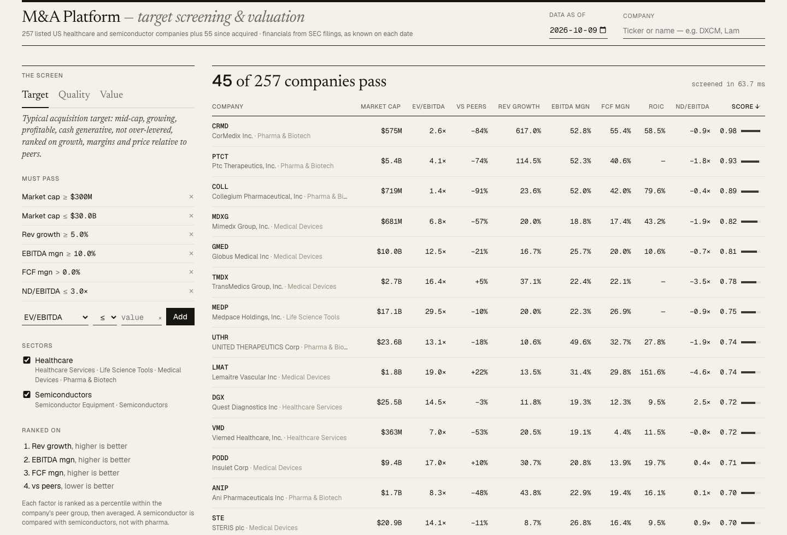
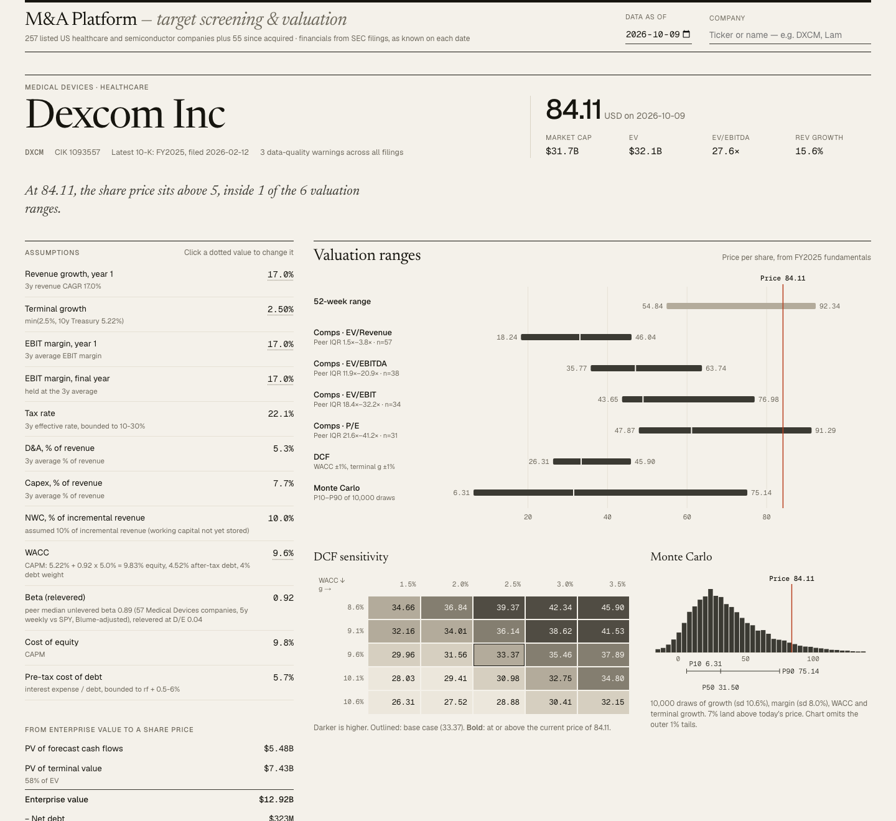
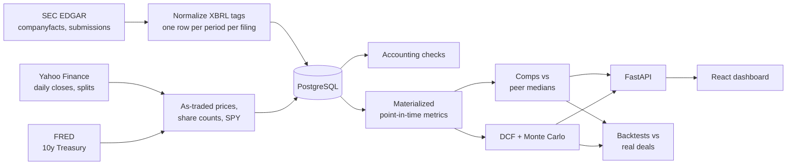
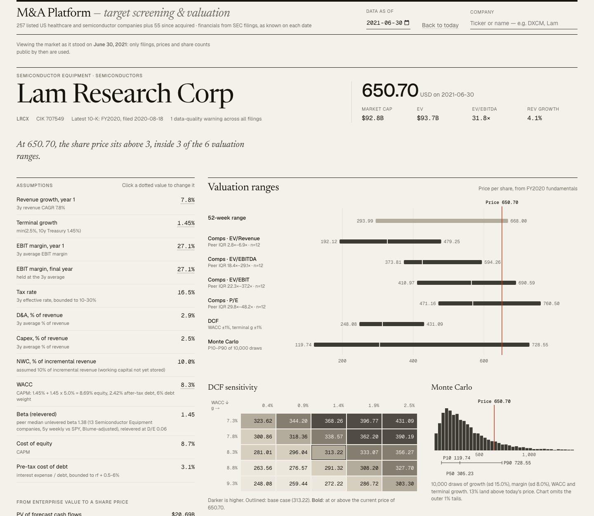

# M&A Platform

A research platform that screens and values US healthcare and semiconductor companies as
acquisition targets, built on a **point-in-time** database of SEC filings, and that **tests
its own accuracy** against real acquisitions.

> Research and learning project, not investment advice. Valuations are mechanical outputs
> of stated assumptions.



## What it does

- **Point-in-time financials.** Pulls every XBRL fact from SEC EDGAR for 257 listed
  companies plus 55 since-acquired targets, and stores each annual figure with the date it
  was filed. Any view can be reconstructed as of a past date, using only what was public
  then, including restatements.
- **Screening and valuation.** A configurable screener ranks companies within their peer
  groups. Each company gets trading comps, a DCF with a bottom-up WACC and a sensitivity
  grid, and a 10,000-draw Monte Carlo DCF, summarized in a football field chart.
- **Backtests.** Ranks real acquisition targets against matched peers before their deals
  were announced, and compares each valuation method with the price actually paid.



## Results

> **Provisional.** The 55 deals were drafted automatically from EDGAR press releases and
> are pending manual verification against their source documents
> (`backend/data/deals_candidates.csv`). Numbers will be updated once verified.

| Test | Result |
|---|---|
| Screener ranking: mean percentile of 50 targets among size-matched peers, one year before announcement (AUC) | 0.48 (95% CI 0.40–0.57, permutation p = 0.67): no better than chance |
| Valuation vs price paid (45 cash deals), median signed error | Comps −35%, DCF −42%, 50/50 blend −36% |
| Valuation vs price paid, median absolute error | Comps 51%, DCF 49%, blend 44% |
| Monte Carlo calibration: deal price inside P10–P90 | 64% of 42 deals vs 80% expected (z = −2.6); misses are mostly above P90 |
| Data quality: statement rows flagged by automated accounting checks | 1,848 of 10,763 with a warning, 60 with an error |
| Full-universe screen | 190 ms → 33 ms after optimization (5.8×) |

What the results say: on growth and margins alone, acquired companies didn't look different
from their peers a year out. Valuations land below deal prices, consistent with a control
premium plus conservative default DCF assumptions, and the Monte Carlo range is too narrow
on the upside. Full write-up, including limitations: `backend/data/backtest/results.md`
(generated by `python -m app.cli backtest`).

## How it works



**Point-in-time data.** A 10-K repeats two or three prior years, sometimes restated, so
each fiscal period is stored once per filing that reported it. The latest version known on
date D is a Postgres `DISTINCT ON (company_id, period_end) … WHERE filed_date <= D ORDER BY
filed_date DESC`. Apple's 2010 restatement of FY2008–2009 revenue (+15–17%) shows up as two
versions of the same years.

**Tag normalization.** Companies label the same concept differently and switch labels over
time. A mapping table with fallbacks handles this, plus derived values (EBIT from pretax
income and interest, total debt from components, revenue from goods and services). Balance
sheets are carried forward as a block from the earlier filing when a later 10-K omits them.
Each value records the tag or derivation it came from.

**Validation.** Checks for Assets = Liabilities + Equity + minority interest + temporary
equity, revenue − COGS = gross profit, impossible values, missing core fields,
restatements and units errors. Running them over the full universe found several
normalizer bugs, such as mixing two filings' balance sheets after ASC 606 restatements.

**Market data.** Prices are stored as actually traded (Yahoo's split adjustment undone),
and share counts come from every 10-K and 10-Q cover page, so market cap is correct across
splits. Nvidia's market cap is ~$1.2T at the end of 2023 and ~$3.3T at the end of 2024,
across its 2024 10-for-1 split.

**Valuation.**
- EV = market cap + debt − cash − short-term investments + minority interest + temporary
  equity.
- Comps apply peer-group median multiples (excluding the company itself) to the company's
  own metrics.
- The DCF fades revenue growth linearly to terminal growth over 10 years, with a Gordon
  growth terminal value and mid-year discounting.
- Beta is bottom-up: 5-year weekly regressions against SPY, Blume-adjusted, unlevered with
  Hamada per peer, then the peer median relevered at the company's D/E.
- The DCF engine is vectorized numpy, so one scenario, the sensitivity grid and 10,000
  Monte Carlo draws share one code path. It is tested against a hand-worked example and
  the growing-perpetuity closed form.
- Monte Carlo draws growth, margin, WACC and terminal growth, with spreads calibrated to
  each company's own history.

**Backtest design.** Acquisitions are rare, so the ranking test is case-control. Each
target is compared with peers in the same peer group with revenue within 3×, as of a year
before announcement. Companies acquired within the following two years are excluded as
controls. Significance comes from a bootstrap over deals and a permutation test.

**Performance.** The full-universe screen originally recomputed metrics for all 10,763
filing rows on every query. The changes, measured with `python -m app.cli benchmark`:

| Change | Before | After |
|---|---|---|
| Materialized metrics view, refreshed after ingest; latest-period selection moved into SQL | 154 ms | 10 ms |
| Index on `prices(trade_date)` for the as-of price window | 16 ms | 7 ms |
| Vectorized "peer median excluding self" (property-tested against the naive loop) | 12 ms | 4 ms |
| **Full-universe screen** | **190 ms** | **33 ms** |
| Full backtest (55 deals, 10k Monte Carlo draws each) | 16.4 s | 9.7 s |



## Stack

Python 3.12+ (pandas, numpy, httpx, SQLAlchemy 2, Alembic, pytest, Ruff) · PostgreSQL 16
in Docker · FastAPI + Pydantic · React + TypeScript (Vite), TanStack Query and Table,
Recharts with custom SVG charts.

## Running locally

Requires Python 3.12+, Node 20+ and Docker.

```bash
# Database (published on 5433 to avoid clashing with a local Postgres)
docker compose up -d

# Backend
cd backend
python -m venv .venv && source .venv/bin/activate
pip install -r requirements.txt
cp .env.example .env            # then put your name and email in SEC_USER_AGENT
alembic upgrade head

python -m app.cli build-universe   # optional: regenerate data/universe.csv
python -m app.cli ingest           # EDGAR financials (~2 minutes, cached afterwards)
python -m app.cli prices           # daily closes, splits, SPY, 10y Treasury
python -m app.cli deals            # acquired targets for the backtests
uvicorn app.main:app --reload      # API on :8000, docs at /docs

# Frontend (second terminal)
cd frontend && npm install && npm run dev   # http://localhost:5173
```

The SEC requires a User-Agent with contact details and allows up to 10 requests per second;
the client stays at 8.

| Command | What it does |
|---|---|
| `python -m app.cli screen --preset target --sector Semiconductors` | Screen the universe; `--filter "ev_ebitda<15"`, `--as-of 2021-06-30` |
| `python -m app.cli comps DXCM --peers` | Comparable-company valuation |
| `python -m app.cli dcf DXCM --wacc 0.09 --as-of 2022-06-30` | DCF, sensitivity grid and Monte Carlo |
| `python -m app.cli show MSFT --metrics` | Annual figures or derived metrics |
| `python -m app.cli flags DXCM --severity warning` | Data-quality flags |
| `python -m app.cli backtest` | Run the backtests on verified deals (`--include-unverified` for a provisional run) |
| `python -m app.cli benchmark 2026-10-09 2019-06-30` | Time the full-universe screen |

Tests: `cd backend && pytest` (55 tests; database tests skip if Postgres isn't running).

## Project layout

```
backend/
  app/edgar/        EDGAR client, XBRL tag map, normalizer
  app/ingest.py     fetch, store and validate one company
  app/validation.py accounting checks
  app/queries.py    point-in-time queries
  app/market.py     prices, splits, share counts, beta
  app/comps.py      EV bridge, multiples, peer medians
  app/dcf.py        DCF engine and WACC; dcf_inputs.py builds default assumptions
  app/monte_carlo.py
  app/screener.py   filters, presets, within-peer-group scoring
  app/backtest.py   ranking, valuation and calibration backtests
  app/api.py        FastAPI routes
  alembic/          migrations, including the metrics views
  data/             universe.csv, deals_candidates.csv, backtest output
frontend/src/       React app: screener, company page, charts
```

## Limitations

- **Annual data only.** Fundamentals come from 10-Ks; there are no trailing-twelve-month
  figures, so multiples can lag by up to about 15 months.
- **Custom XBRL tags are invisible.** EDGAR's companyfacts API only includes standard
  tags, so some lines that companies report under their own tags are missing (Microsoft's
  D&A, Nvidia's capex, Medivation's revenue). These are flagged rather than guessed.
- **Prices come from yfinance,** which is unofficial and has no delisted tickers, so the
  backtest ranking uses fundamentals only.
- **Default DCF assumptions are simple and conservative.** They extrapolate the trailing
  3-year CAGR, so acquisition-driven growth is treated as organic. Working capital is
  assumed at 10% of incremental revenue.
- **Backtest caveats.** A few dozen hand-picked deals, survivors in the control group, and
  deal prices that include a control premium. See the limitations section of the backtest
  report.
